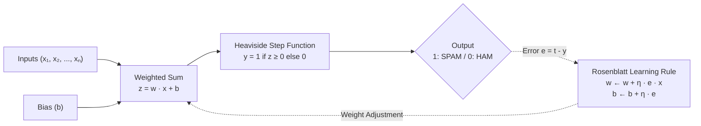

# 📧 Email Spam Classification Using a Single-Layer Perceptron
**Course:** 21CSE326T — Artificial Neural Networks  
**Implementation:** Pure NumPy (from-scratch "Glass-Box" architecture)

[](https://colab.research.google.com)
[](https://www.python.org/)
[](LICENSE)

---

## 📌 1. Project Overview

This project provides an educational, end-to-end demonstration of a **Single-Layer Perceptron (SLP)** applied to email spam classification. Rather than treating neural networks as opaque "black boxes" via modern deep-learning libraries, this repository implements every element—from the weighted sum and Heaviside step activation to Rosenblatt's weight-update rule and Gallant's Pocket Algorithm—**strictly from scratch using only NumPy**.

The repository supports two complementary learning tracks:
1. **Interactive Glass-Box Web Dashboard**: A visual interface built with Flask and SVG canvas to observe live decision boundaries, weight updates point-by-point, and adversarial spam evasion attacks.
2. **57-Feature Real-World Benchmark**: Training and evaluating on the official **UCI Spambase Dataset** (4,601 instances), matching baseline Logistic Regression performance with ~91.6% test accuracy.

---

## 🔬 2. Mathematical Formulation



### A. Net Input (Dot Product + Bias)
For an input vector $\mathbf{x} = [x_1, x_2, \dots, x_n]^T \in \mathbb{R}^n$, weight vector $\mathbf{w} = [w_1, w_2, \dots, w_n]^T$, and scalar bias $b$:
$$z = \mathbf{w} \cdot \mathbf{x} + b = \sum_{i=1}^n w_i x_i + b$$

### B. Activation Function (Heaviside Step)
$$\hat{y} = \text{step}(z) = \begin{cases} 1 & \text{if } z \ge 0 \quad (\text{Spam}) \\ 0 & \text{if } z < 0 \quad (\text{Legitimate / Ham}) \end{cases}$$

### C. Rosenblatt's Perceptron Learning Rule (1958)
For target label $t \in \{0, 1\}$ and predicted label $\hat{y} \in \{0, 1\}$, the error signal is $e = t - \hat{y}$:
$$\mathbf{w}^{(k+1)} = \mathbf{w}^{(k)} + \eta \cdot (t - \hat{y}) \cdot \mathbf{x}$$
$$b^{(k+1)} = b^{(k)} + \eta \cdot (t - \hat{y})$$
where $\eta \in (0, 1]$ represents the learning rate.
* **Correct prediction ($e = 0$)**: No update is made ($\Delta \mathbf{w} = 0, \Delta b = 0$).
* **False Negative ($t=1, \hat{y}=0 \implies e=+1$)**: $\mathbf{w} \leftarrow \mathbf{w} + \eta \mathbf{x}$ and $b \leftarrow b + \eta$, shifting the hyperplane to favor positive classification.
* **False Positive ($t=0, \hat{y}=1 \implies e=-1$)**: $\mathbf{w} \leftarrow \mathbf{w} - \eta \mathbf{x}$ and $b \leftarrow b - \eta$, shifting the hyperplane away from positive classification.

### D. The Pocket Algorithm Variant (Gallant, 1990)
The classical Perceptron Convergence Theorem guarantees convergence **only if** the data is linearly separable. Real-world emails overlap. A vanilla perceptron oscillates indefinitely and may end on a suboptimal iteration.
The **Pocket Algorithm** tracks training accuracy after every epoch and keeps the best weights $(\mathbf{w}_{\text{best}}, b_{\text{best}})$ "in its pocket," restoring them when training completes.

---

## 📂 3. Repository Structure

```
spam-perceptron/
├── backend/
│   ├── app.py                     # Flask REST API & Web Server
│   ├── data.py                    # 5-Feature extractor & synthetic generator
│   ├── perceptron.py              # From-scratch Perceptron, Metrics & LogReg
│   ├── train_spambase.py          # Standalone training script for UCI Spambase
│   └── data/
│       ├── spambase.data          # UCI Spambase raw dataset (4,601 rows x 58 cols)
│       ├── spambase.names         # Official feature descriptions & definitions
│       └── spambase_perceptron.npz# Serialized weights, bias & normalization stats
├── frontend/
│   └── index.html                 # Interactive Glass-Box Web Dashboard (SVG/Canvas)
├── Email_Spam_Perceptron.ipynb    # Self-contained Google Colab & Jupyter Notebook
├── requirements.txt               # Python dependencies (flask, numpy, matplotlib)
└── README.md                      # Comprehensive Project Documentation
```

---

## 📊 4. Datasets Used

### Track 1: 5-Feature Transparent Model
Designed for visual interpretability and live interactive testing:
1. **Suspicious links**: Density of `http://`, `www.`, and URL shorteners (`bit.ly`).
2. **Spam keywords**: Occurrences of trigger terms (`free`, `winner`, `prize`, `urgent`, `cash`, `claim`).
3. **Sender reputation**: Heuristic scoring based on top-level domain (`.edu`/`.gov` $\rightarrow 0.9$, `.xyz`/`.biz` $\rightarrow 0.1$, random digits/hyphens penalize).
4. **CAPS ratio**: Ratio of uppercase letters to total alphabetic characters.
5. **Exclamation count**: Frequency of exclamation marks (`!`).

### Track 2: 57-Feature Official UCI Spambase Dataset
Created at Hewlett-Packard Labs (Hopkins, Reeber, Forman, Suermondt, 1999):
* **4,601 Total Emails**: 1,813 Spam (39.4%) and 2,788 Ham (60.6%).
* **Features 1–48**: Word frequency percentages ($100 \times \frac{\text{count}}{\text{total words}}$).
* **Features 49–54**: Character frequency percentages (`;`, `(`, `[`, `!`, `$`, `#`).
* **Features 55–57**: Capital run-length statistics (average, longest, total).
* **Feature 58**: Target label (`1` = Spam, `0` = Ham).
* **Critical Preprocessing**: The raw dataset orders all spam first; rows are randomly permuted and standardized using Z-score scaling ($x_{\text{norm}} = \frac{x - \mu}{\sigma + 10^{-9}}$).

---

## 🚀 5. Quickstart Guide

### Prerequisites
* Python 3.8+ (Anaconda or standard CPython)

### 1. Install Dependencies
```bash
pip install -r requirements.txt
```

### 2. Launch the Interactive Web Dashboard
```bash
cd backend
python app.py
```
Open your browser and navigate to: **[http://127.0.0.1:5000](http://127.0.0.1:5000)**

### 3. Run the Standalone 57-Feature Benchmark
```bash
cd backend
python train_spambase.py
```

### 4. Run the Jupyter / Google Colab Notebook
Open [`Email_Spam_Perceptron.ipynb`](file:///c:/Users/kanak/Downloads/spam-perceptron/Email_Spam_Perceptron.ipynb) in VS Code or upload it to [Google Colab](https://colab.research.google.com). It runs self-contained and automatically downloads the dataset if running in the cloud.

---

## 🖥️ 6. Web Dashboard Walkthrough

The web dashboard is organized into three exploratory panels:

| Tab | Feature | Description |
| :--- | :--- | :--- |
| **① Live Classifier** | Real-time Neural Diagram | Interactive SVG neural network showing node activations, signed edge weights (red = spam push, green = legit push), and exact mathematical breakdown of $z = \sum w_i x_i + b$. Includes **Spam Evasion Simulation** showing how spammers game linear models. |
| **② Training Lab** | 2D Boundary Trajectory | Animates step-by-step weight updates on the 2D plane (Keywords vs. Sender Reputation) with full equation derivations for each misclassification. |
| **③ Insights** | Benchmark & Diagnostics | Comprehensive metrics on test sets, Confusion Matrix, ROC/AUC curve ($0.967$), feature ablation importance, and the **XOR non-linear failure mode**. |

---

## 📈 7. Experimental Results

Evaluated on unseen test data from the UCI Spambase dataset ($N = 921$ emails, 80/20 train-test split):

| Metric | Perceptron (Scratch + Pocket) | Logistic Regression Baseline |
| :--- | :---: | :---: |
| **Training Accuracy** | **91.74%** | 92.83% |
| **Test Accuracy** | **91.64%** | 91.53% |
| **Test Precision** | **92.51%** | 92.24% |
| **Test Recall** | **86.29%** | 86.02% |
| **Test F1-Score** | **89.29%** | 89.02% |
| **ROC AUC** | **0.967** | 0.969 |

### Confusion Matrix (Test Set)
* **True Negatives (Legitimate correctly identified)**: `523`
* **False Positives (Legitimate marked as Spam)**: `26`
* **False Negatives (Spam missed)**: `51`
* **True Positives (Spam detected)**: `321`

### Learned Feature Importance
* **Top SPAM Indicators ($w_i > 0$)**: `char_freq_$` (+0.171), `word_freq_font` (+0.163), `word_freq_remove` (+0.149), `char_freq_!` (+0.134), `char_freq_#` (+0.133).
* **Top LEGITIMATE Indicators ($w_i < 0$)**: `word_freq_george` (-0.758), `word_freq_hp` (-0.275), `word_freq_cs` (-0.225), `word_freq_project` (-0.158), `word_freq_meeting` (-0.138).

---

## ⚠️ 8. Key Architectural Insights & Limitations

1. **Linear Separability Requirement**: A single-layer perceptron constructs a linear hyperplane. In non-linearly separable scenarios (such as XOR or complex natural language syntax), an SLP fails (~50% accuracy). This justifies why modern NLP utilizes Multi-Layer Perceptrons (MLPs) and Transformers.
2. **Susceptibility to Adversarial Evasion**: Because the decision surface is strictly linear, adversarial spammers can evade the filter by perturbing high-magnitude weights (e.g., adding legitimate terms or removing specific trigger characters).
